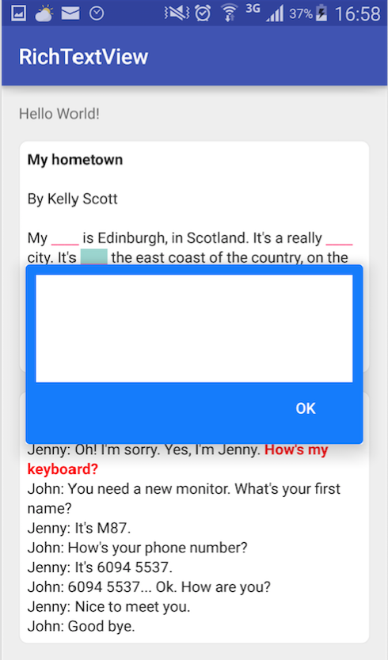
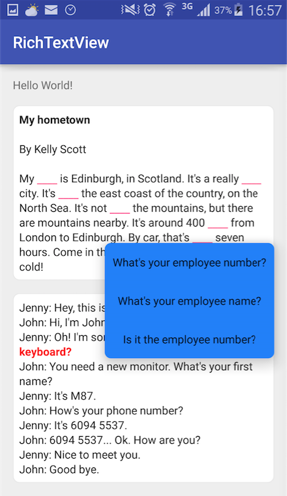

# RichTextView [](https://www.codacy.com/manual/cray_bond/RichTextView?utm_source=github.com&amp;utm_medium=referral&amp;utm_content=rayworks/RichTextView&amp;utm_campaign=Badge_Grade)

The customized `TextView` provides a way to select text from input window to fill up inner blanks.

## Import to your project

### Gradle

```groovy
repositories {
    ...
    maven { url 'https://jitpack.io' }
}

dependencies {
    implementation 'com.github.rayworks:RichTextView:3.0.0'
}
```

> **3.0.0** adds the Jetpack Compose `GapFillText` and raises the minimum SDK to **21**
> (previously 15). Apps that still support API 15–20 should stay on `2.0.0`.

## Snapshots




## Instructions

`GapFillTextView` can be treated as normal text view, besides that, it provides 2 ways to fill the gaps marked by '{*}'.

### Jetpack Compose

The library also ships a Compose reimplementation, `GapFillText`, with the same input styles,
answer colouring, deletion option, review mode and `AnswerCorrectionChecker` / `AnswerResultObserver` callbacks.

```kotlin
val state = rememberGapFillState()

GapFillText(
    config = GapFillConfig(
        rawText = "My {} is Edinburgh. It's a really {} city.",
        optionItems = listOf(listOf("home", "hometown"), listOf("nice", "", "big")), // "" = delete option
        inputStyle = InputStyle.POPUP_WINDOW, // or InputStyle.EDITOR_TEXT
    ),
    state = state,                 // state.filledAnswers, state.reset(), state.formattedFullText(raw)
    answerChecker = checker,       // optional
    resultObserver = observer,     // optional
)
```

See `ComposeSampleActivity` in the sample app (opened from the "Open Compose version" button).

## Note

Besides the stand html text string, you also can use predefined combined symbols as a shortcut in the raw string which will be consumed by the widget.

bold : \*\*bold\*\* or \_\_bold\_\_

highlight: \*\*\*highlighted\*\*\* or \_\_\_highlighted\_\_\_

italic: \*italic\* or \_italic\_
 
### License

```
Copyright 2016 rayworks

Licensed under the Apache License, Version 2.0 (the "License");
you may not use this file except in compliance with the License.
You may obtain a copy of the License at

   http://www.apache.org/licenses/LICENSE-2.0

Unless required by applicable law or agreed to in writing, software
distributed under the License is distributed on an "AS IS" BASIS,
WITHOUT WARRANTIES OR CONDITIONS OF ANY KIND, either express or implied.
See the License for the specific language governing permissions and
limitations under the License.
```
